# RAR Woo Smart Courier Pro

      

Multi-courier shipping and dispatch for WooCommerce stores in Bangladesh. It gives customers one courier choice per company at checkout, each with a price, a delivery time and an estimated arrival date. Behind the scenes it gives your team a dispatch board, parcel labels, hand-over manifests, tracking and a courier performance dashboard.

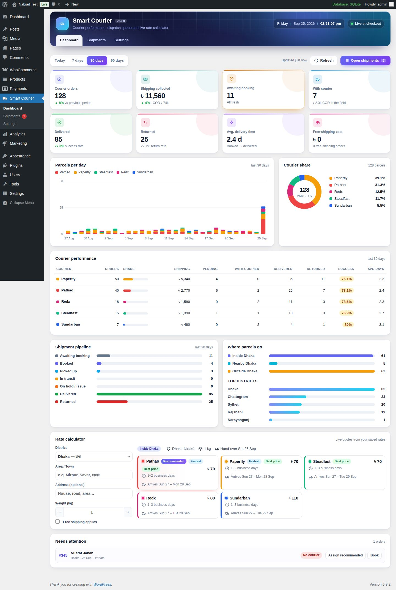

## Download

### [Download RAR Woo Smart Courier v3.1.2 installable ZIP](https://github.com/ruhulaminrevens/RAR-Woo-Smart-Courier-Pro/releases/latest/download/rar-woo-smart-courier-v3.1.2.zip)

- **Installable ZIP:** [GitHub Releases](https://github.com/ruhulaminrevens/RAR-Woo-Smart-Courier-Pro/releases) (published only after CI passes). The release ZIP has one installable `rar-woo-smart-courier` folder.
- **Build/CI logs:** [GitHub Actions](https://github.com/ruhulaminrevens/RAR-Woo-Smart-Courier-Pro/actions/workflows/quality.yml): PHP 7.4/8.2/8.3 syntax and regression tests, JavaScript syntax, ZIP/sha256. CI is not proof of live courier booking or HPOS integration.
- **Source code:** [Download the repository as ZIP](https://github.com/ruhulaminrevens/RAR-Woo-Smart-Courier-Pro/archive/refs/heads/main.zip). This is for developers; don't upload it to WordPress.

### Install in 1 minute

1. Take a **full backup** of your site (files + database).
2. WordPress → **Plugins → Add New → Upload Plugin** → choose `rar-woo-smart-courier-v3.1.2.zip` → **Install Now** → **Activate**.
3. **Already using v1.x?** Choose **Replace current with uploaded**. Your settings and older orders are converted automatically; see [Upgrading from 1.x](#upgrading-from-1x).
4. Open **Smart Courier → Settings**, enter your courier rates, and test with **Safe Test Mode ON** before going live.

The plugin shows up in WordPress as **RAR Woo Smart Courier**. It keeps the same plugin folder (`rar-woo-smart-courier`) as v1.x, so it upgrades your existing installation in place. The full checklist is in [docs/INSTALLATION.md](docs/INSTALLATION.md).

## What's new in 3.1.2

Integration-tested release on **WordPress 7.1 + WooCommerce 11.3**, legacy and HPOS order storage, with RAR Courier Suite active and inactive.

- **Suite parcel import starts reliably.** The resumable migration now runs after WooCommerce has registered orders (`wp_loaded`). Earlier builds could run at `plugins_loaded`, find nothing and mark the import complete. Upgrading restarts the scan once.
- **Correct SteadFast tracking.** The customer tracking link and Shipments board use SteadFast's `tracking_code`, not the numeric consignment id.
- **Auto-send and bulk bookings appear on the Shipments board** with the right tracking number and status.
- **Your courier choice wins.** An auto-recommended courier no longer overrides the courier set in Settings or picked at checkout.
- **Tools & Health** has both *Continue parcel migration* and a repeatable *Import from RAR Courier Suite* button.

## What's new in 3.0 — RAR Courier Suite is built in

Version 3 merges the stand-alone **RAR Courier Suite** into this plugin. One plugin now covers the whole flow: the customer picks a courier at checkout, your team books the parcel through the courier's API, and status flows back by webhook and cron.

- **Pathao, RedX, SteadFast, Paperfly** API booking (single + bulk) and **Sundarban** manual CN entry, from the Orders list or the order screen.
- **Duplicate-send protection:** one DB lock per order across all couriers, one courier per order, 10-minute block after an uncertain timeout.
- **Hardened webhooks** (Pathao signature, SteadFast token) plus a 30-minute status-sync safety net; statuses never go backwards from a final state.
- **COD-aware amounts** including RAR Advance Payment and prepaid gateways.
- **Encrypted API secrets**, `wp-config.php` constants, redacted logs.
- **Bridge to the shipment board:** every API booking and status change updates the Shipments board, Dashboard, labels, manifests and tracking page automatically.
- **Courier APIs** and **Tools & Health** pages under the Smart Courier menu.

### Replacing RAR Courier Suite — safe cutover checklist

1. **Back up all WordPress files and the database.** Export/check the source Suite settings (`pt_hms_settings`), the Pro API settings (`rwsc_api`), and the original order parcel meta (`ptc_*`, `rdx_*`, `sfc_*`, `pf_*`, `sdb_*`, `_rwsc_*`). Never upload unmasked API credentials.
2. Install **v3.1.2 on staging** with Suite still active: its dispatch functions remain paused to avoid two copies registering webhooks and cron jobs. Legacy original Pathao/RedX/SteadFast plugins also pause embedded dispatch if detected; deactivate overlapping integration plugins only after confirming their parcels are retained.
3. At **Smart Courier → Courier APIs**, confirm migrated credentials and run each connected provider's **Test connection**. A field saying *Configured* proves only stored credentials, not a live successful booking.
4. Under **Smart Courier → Tools & Health**, use **Continue parcel migration** as needed until the Suite import scans all records. Compare counts and IDs/statuses of old and new parcels, including oldest and newest orders. Run dedicated RedX/SteadFast legacy importer and HPOS old-Pathao meta migration repeatedly if relevant.
5. **On staging only**, deactivate Suite (do not delete), then test one controlled parcel for each courier enabled: single/bulk booking, duplicate-submit lock, COD, tracking, customer email, webhook, cron, terminal statuses, label and manifest.
6. Repeat under backup/low traffic on production with auto-dispatch paused. **Only after passing real checks**, keep Suite's **Delete data on uninstall = No** and remove Suite. On failure, reactivate it and review courier merchant-panel parcel IDs first.

**Important:** The import completion flag is NOT proof of a lossless cutover. Verify complete source/target counts and sample consignments before uninstalling. Timed-out API calls may already have created parcels; inspect the courier panel rather than retrying immediately. Details: [installation / rollback checklist](docs/INSTALLATION.md) and [v3.1 source audit](docs/AUDIT-2026-11-14.md).

## What's new in 2.0

- **Correct Dhaka detection.** v1.x compared the address against the word "Dhaka". WooCommerce actually stores districts as codes such as `BD-13`, so every order got the "Outside Dhaka" rate. v2 understands WooCommerce codes, English and বাংলা district names, and common old spellings (Chittagong, Comilla, Jessore…).
- **Correct weights.** Product weights are converted from g, lbs or oz to kg. v1.x treated 500 g as 500 kg.
- **Nearby areas win over "Dhaka".** Savar, Ashulia, Keraniganj and similar areas get the Nearby rate even when the customer picks Dhaka district. The area name can come from the city or the address line.
- **Works with HPOS and the Cart/Checkout blocks.** This is declared to WooCommerce and tested with both order storage modes.
- **New:**
  - Courier dashboard
  - Shipments board
  - Tracking numbers and statuses
  - Customer tracking
  - Parcel labels with barcodes
  - Hand-over manifests
  - CSV export
  - Estimated delivery dates
  - Badges at checkout
  - Unlimited custom couriers

## Features

### Checkout

- One option per enabled courier. Each shows its price and delivery time, plus an **estimated arrival date** such as "Arrives Sun 27 – Mon 28 Sep". The date skips your weekly off-days and holidays and respects your same-day cut-off time.
- Badges: **Recommended**, **Fastest** and **Best price**. The recommended courier is listed first and pre-selected.
- Three recommendation modes:
  - **Smart:** fastest, then cheapest, then your priority.
  - **Cheapest first.**
  - **My priority.**
- Three zones: Inside Dhaka, Nearby Dhaka and Outside Dhaka.
  - The Nearby districts are configurable (default Gazipur and Narayanganj).
  - So are the Nearby areas inside Dhaka district (Savar, Ashulia, Keraniganj, Dohar, Dhamrai, Nawabganj, with English and বাংলা names).
  - There is an optional list of areas that should always count as "Inside Dhaka" (e.g. Tongi).
- Weight pricing uses three prices per zone: up to 1 kg, up to 2 kg, then an extra charge for every started kg above 2 kg. There is a fallback weight for products without one and an optional packaging weight.
- Each courier can have a maximum weight and can be turned off for individual zones.
- WooCommerce **Free shipping** keeps working. Either every courier becomes free, or only the recommended one. The normal price is shown struck through.
- Tax on shipping is recalculated for each courier's price. Local pickup stays available.
- Two label styles for the classic checkout: detailed or compact. The Checkout block shows the name, badge, price, delivery time and date.
- **Safe Test Mode.** While it is on, only shop managers see the couriers.

### Dispatch

- **Shipments board** with tabs: Ready to book · With courier · Booked · Picked up · In transit · On hold · Delivered · Returned · No courier · All.
  - Search by order, name, phone, tracking number or area. Filter by courier, zone and period.
  - Change the courier, tracking number and status inline.
  - Type a tracking number and press **Enter**. The parcel is saved as **Booked** and the cursor jumps to the next row.
  - Bulk actions: set courier, set status, print labels, manifest, CSV.
  - The details drawer shows items, notes and the shipment timeline. **Copy parcel info** gives you text to paste into a courier merchant panel.
- **Parcel labels** with a Code 128 barcode. Sizes: A4 (8 per page), 4×6 in thermal or A6. Each label shows the COD amount, recipient, phone, address, district, zone, item count, weight and sender.
- **Hand-over manifest** grouped by courier, with COD and weight totals and signature lines.
- **CSV export**, UTF-8 so Bangla text opens correctly in Excel, with spreadsheet-formula protection.
- **Order screen:**
  - A Smart Courier box to set the courier (or "Recommended"), tracking number, status and note. It also shows a progress bar, timeline and label link.
  - A Courier column in the orders list, with courier and shipment-status filters.
  - Bulk actions in the orders list.

### Automation & customers

- Orders created by phone, from the admin, or with the **RAR Woo Stock & Order** staff app are auto-assigned the recommended courier when they reach a "ready" status.
- The customer is emailed when a tracking number is added. The email is sent as a WooCommerce customer note and includes the tracking link and delivery estimate.
- A delivery card on the thank-you page and in My Account → Orders, with a **Track** button.
- Courier, delivery time and tracking are added to order emails.
- A public tracking page (`[rwsc_tracking]`) where customers enter their order number and phone number. It is rate-limited and a page can be created with one click.
- Optional: mark the order **Completed** when the parcel is delivered, and change the order status when a parcel is returned.

### Dashboard

- Today, 7, 30 or 90 days:
  - courier orders and shipping collected (compared with the previous period)
  - parcels awaiting booking (with a stale warning) and parcels with the courier (COD still to collect)
  - delivered with success rate, returned with return rate
  - average delivery time and the cost of free shipping
- Parcels per day by courier, courier share, a courier performance table, the shipment pipeline, zones and top districts.
- A **rate calculator**: pick a district, area and weight to get live quotes.
- A **Needs attention** list and a **Setup check**. The setup check flags a missing Bangladesh shipping zone, test mode, missing product weights and similar problems.

### Settings (tabbed)

- **Couriers & rates:** colour, priority, tracking-link template (`{tracking}`, `{phone}`, `{order}`), max weight and a zone price matrix. Add or remove custom couriers.
- **Zones & weight:** a district picker for all 64 districts grouped by division, with Bangla names and search; area tags; an address-matching toggle; and an address tester.
- **Checkout display:** engine switch, test mode, recommendation mode, label style, badges, free-shipping mode and a live label preview.
- **Delivery dates:** off-days, cut-off time and holidays, with one click to add the fixed-date national holidays.
- **Tracking & automation**, **COD methods** and **sender details** for labels.
- **Tools:** export and import settings as JSON, reset to defaults, and system status.

## How it works

1. Create a WooCommerce shipping zone for **Bangladesh** with a **Flat rate** method, plus **Free shipping** if you use it. The flat rate is only the anchor: Smart Courier replaces it with one option per courier, using your courier prices.
2. For each package, the plugin:
   - resolves the district and zone from the address;
   - calculates the parcel weight in kg;
   - prices each enabled courier;
   - works out the ETA and delivery date;
   - sorts the couriers and adds badges.
3. The chosen courier is stored on the order: courier, ETA, estimated date, zone, district and weight. The shipment then moves **Awaiting booking → Booked → Picked up → In transit → Delivered / Returned**, or **On hold** when there is a problem.

**Checkout charges use your configured courier rate matrix, not real-time provider pricing.** Separately, the API dispatch module calls supported providers for bookings/status updates when enabled. Sundarban is manual CN-only. Paperfly and some RedX endpoints require merchant-side validation.

## Upgrading from 1.x

- Settings are migrated automatically. Nearby district names become WooCommerce codes, "nearby cities" become "nearby areas", and your courier prices and ETAs are kept.
- Orders placed with v1.x receive a courier key and a shipment status in the background: Completed orders are marked Delivered, other orders Awaiting booking. This runs in batches of 100 while an admin is logged in.
- Order data is never deleted. Uninstalling the plugin keeps all settings and order meta.

## Developers

```php
rwsc_get_quotes( array( 'country' => 'BD', 'state' => 'BD-13', 'city' => 'Mirpur' ), 1.5 );   // quotes for 1.5 kg
rwsc_get_shipment( $order );                                                                // courier, tracking, status, ETA…
rwsc_update_shipment( $order, array( 'tracking' => 'ABC123', 'status' => 'booked' ) );
```

- **Filters:**
  - `rwsc_quotes`, `rwsc_courier_cost`, `rwsc_package_weight`, `rwsc_order_weight`
  - `rwsc_base_rate`, `rwsc_package_rates`, `rwsc_pickup_methods`
  - `rwsc_tracking_url`, `rwsc_customer_tracking_message`, `rwsc_shipment_statuses`
  - `rwsc_view_capability`, `rwsc_manage_capability`
- **Actions:** `rwsc_shipment_updated`, `rwsc_shipment_status_changed`, `rwsc_settings_saved`.
- **Order meta:**
  - courier and assignment: `_rwsc_courier`, `_rwsc_selected_courier`, `_rwsc_zone`, `_rwsc_district`, `_rwsc_eta`, `_rwsc_edd`, `_rwsc_weight`
  - shipment: `_rwsc_tracking`, `_rwsc_status`, `_rwsc_note`, `_rwsc_log`
  - timestamps: `_rwsc_booked_at`, `_rwsc_delivered_at`, `_rwsc_returned_at`

## Repository structure

```text
rar-woo-smart-courier.php          Bootstrap, HPOS + blocks compatibility
includes/
  class-rwsc-plugin.php            Orchestrator, upgrade routine
  class-rwsc-settings.php          Defaults, sanitising, migration
  class-rwsc-locations.php         64 districts (codes, Bangla, aliases), zone resolution
  class-rwsc-engine.php            Weight, cost, ETA, delivery dates, quotes, rate filter, labels
  class-rwsc-shipments.php         Shipment model, auto-assign, status/tracking updates, v1 backfill
  class-rwsc-reports.php           SQL reads for dashboard + board (HPOS and legacy)
  class-rwsc-orders-admin.php      Order meta box, list column, filters, bulk actions
  class-rwsc-admin.php             Menus, settings page, health checks
  class-rwsc-ajax.php              Admin AJAX endpoints
  class-rwsc-print.php             Labels (Code 128), manifest, CSV
  class-rwsc-frontend.php          Checkout styles, customer card, emails, tracking shortcode
  functions.php                    Public helper API
assets/css, assets/js              Admin app + storefront styles
languages/                         Translation template
docs/                              Installation guide, screenshots
releases/                          Installable ZIPs
```

## Compatibility

- WordPress 6.2+ · WooCommerce 8.0+ (tested with 10.1) · PHP 7.4+ (tested with 8.4).
- High-Performance Order Storage and legacy posts storage.
- Classic cart and checkout (shortcodes) and the Cart/Checkout blocks.
- Taxes on shipping, WooCommerce Free shipping, Local pickup, and cash on delivery restricted to "Flat rate".

## Screenshots

| | |
|---|---|
| 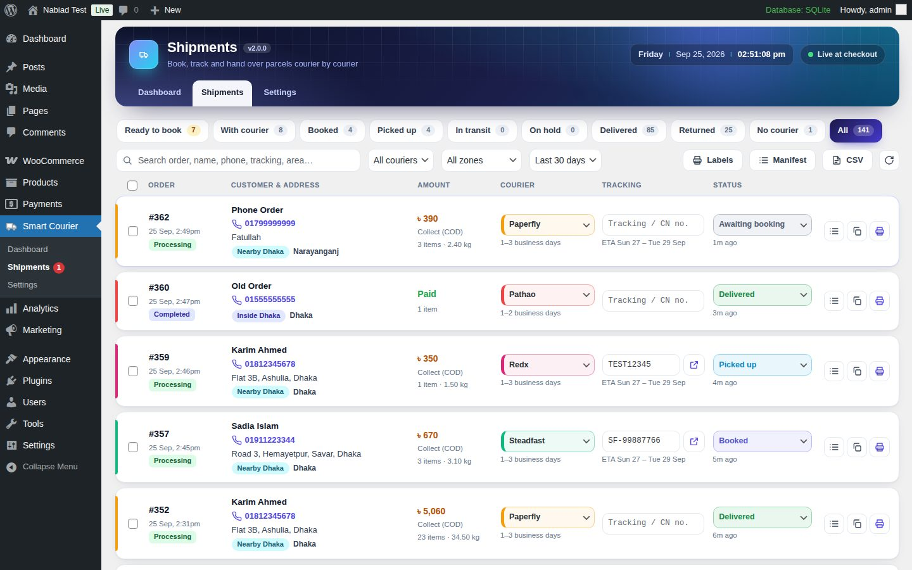 | 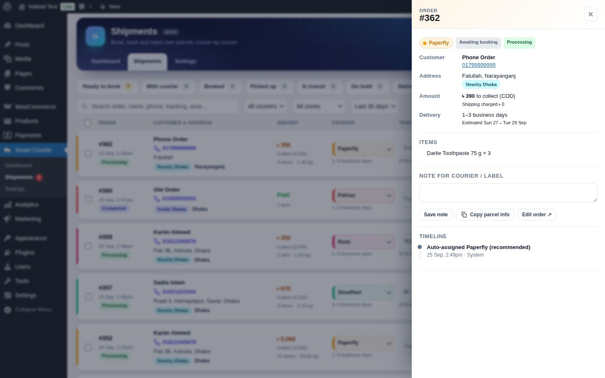 |
| 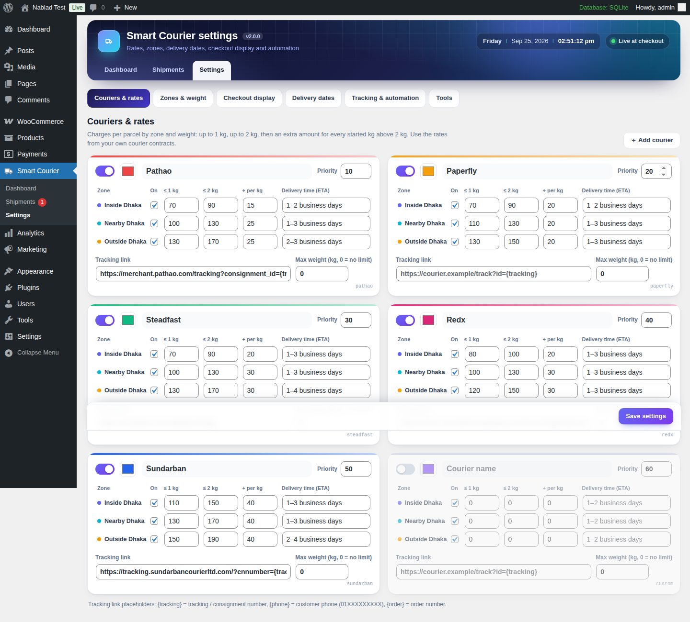 | 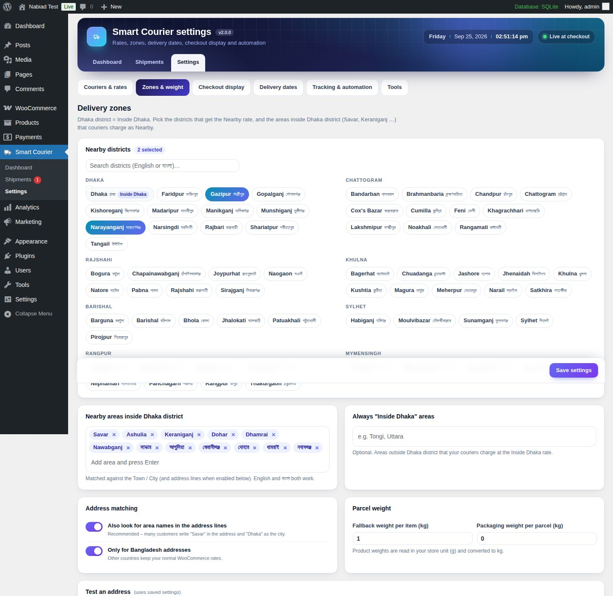 |
| 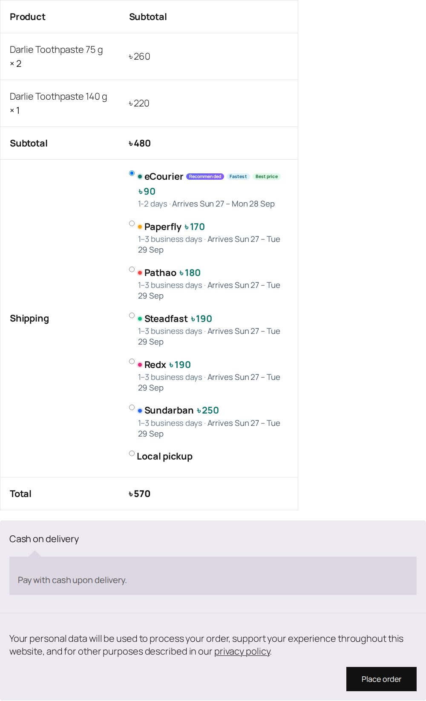 | 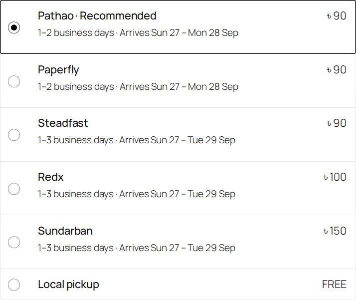 |
| 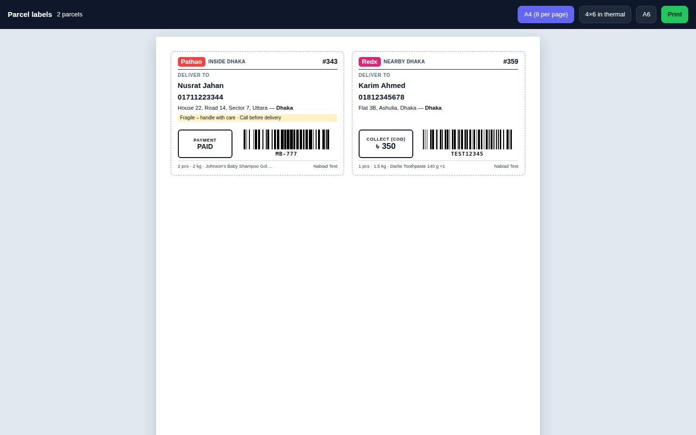 | 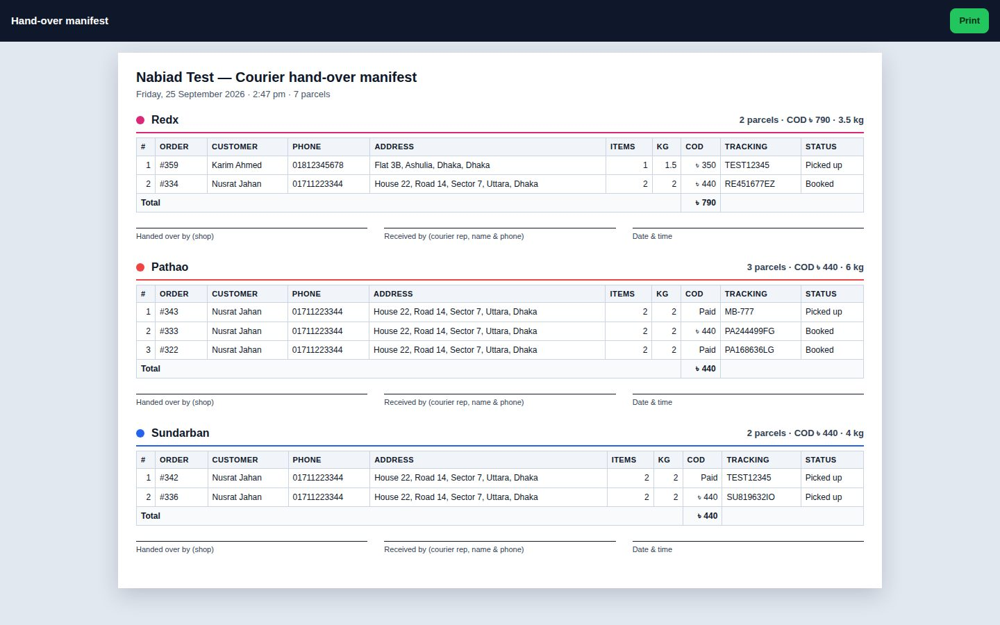 |
| 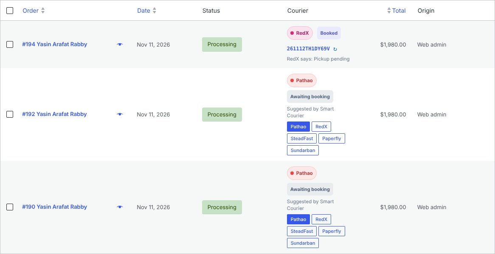 | 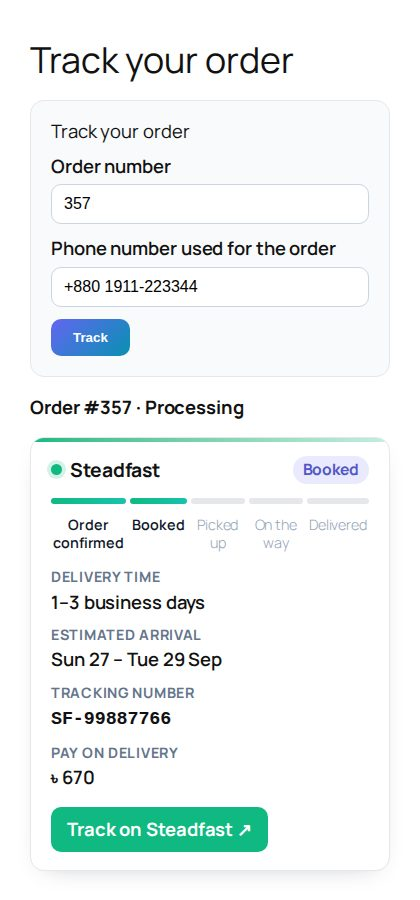 |

## Version

**v3.1.2 — 2026-11-14 (CI checked; staging and provider tests required).** See [CHANGELOG.md](CHANGELOG.md).

## License

GPL-3.0-or-later
